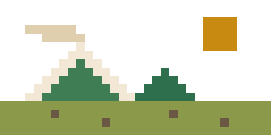

# THE SLY CAT — 极简像素风个人博客

Markdown 写文章 → 本地构建成静态 HTML → `git push` 发布。没有后台，没有云端构建，没有数据库。

## 目录

```
posts/          文章，.md 格式，一篇一个文件
pages/          独立页面（about.md → /about/）
assets/         图片 / 视频，原样复制到站点 /assets/
src/styles/     CSS（main.css）与字体声明（fonts.css，自动生成）
src/templates.mjs   HTML 骨架
src/fonts/      自托管字体 woff2（自动生成）
scripts/        build / serve / fetch-fonts
site.config.js  站名、简介、导航、RSS 地址
docs/           构建产物 —— 这个目录提交到 git，Pages 直接读它
```

## 写一篇

在 `posts/` 里新建 `.md`，文件名建议 `2026-10-11-some-title.md`（日期前缀会自动变成发布日期，英文 slug 会成为 URL）：

```markdown
---
title: 标题
date: 2026-10-11
tags: [跑步, 数据]
summary: 首页显示的一句话摘要，不写就自动截正文前 140 字。
---

正文。图片放 `assets/` 里，这样引用：



视频后缀会自动变成播放器：


```

### frontmatter 字段

| 字段 | 作用 | 省略时 |
| --- | --- | --- |
| `title` | 标题 | 取正文首个 `#` 标题，再没有用文件名 |
| `date` | 日期 | 文件名日期前缀 → 文件修改时间 |
| `tags` | 标签，数组或单个字符串 | 无 |
| `summary` | 摘要 | 自动截取正文前 140 字 |
| `draft` | `true` 时跳过构建 | 默认发布 |
| `slug` | 自定义 URL 片段 | 用文件名去掉日期前缀 |

## 命令

```bash
npm install       # 首次
npm run build     # 构建到 docs/
npm run serve     # 本地预览 http://localhost:4173
npm run fonts     # 重新下载自托管字体（只在改字体时才需要跑）
```

构建带草稿预览：`npm run build -- --drafts`

## 发布

1. 仓库 **Settings → Pages → Build and deployment → Source** 选 **Deploy from a branch**
2. Branch 选 `main`，目录选 **`/docs`**，保存
3. 之后每次：

```bash
npm run build
git add -A && git commit -m "new post" && git push
```

> GitHub Pages 的分支部署只认仓库根目录或 `/docs`，所以产物落在 `docs/` 而不是 `dist/`。
> 想改成别的目录，编辑 `site.config.js` 里的 `outDir`。

推送后 `.github/workflows/build-check.yml` 会在云端再构建一次——它只做校验，不发布，构建挂了会告诉你。

## 字体

- 英文 / 数字 / UI：**Press Start 2P**（经典 8-bit 像素）
- 中文标题：**站酷庆科黄油体**（圆润、有卡通感）
- 中文正文：**霞鹜文楷 LXGW WenKai** Regular（[lxgw/LxgwWenKai](https://github.com/lxgw/LxgwWenKai)，楷体风，长段落读着不累）

三个字体都下载到 `src/fonts/` 自托管，**不依赖 Google Fonts CDN**，国内访问正常。中文按 unicode-range 分片，浏览器只下载页面实际用到的几片。

换字体：编辑 `scripts/fetch-fonts.mjs` 顶部的 `SOURCES`（支持 Google Fonts 家族名，也支持任意 CSS 地址），然后 `npm run fonts && npm run build`。

配色是浅色复古纸（米黄纸 + 深棕墨），改 `src/styles/main.css` 顶部的 CSS 变量即可。

## 换掉默认内容

- 站名 / 简介 / 导航 → `site.config.js`
- 头像 → 替换 `src/avatar.svg`（当前是只像素黑猫，16×16 网格画的）
- 关于页 → `pages/about.md`
- 示例文章 → 删掉 `posts/` 里那两篇
